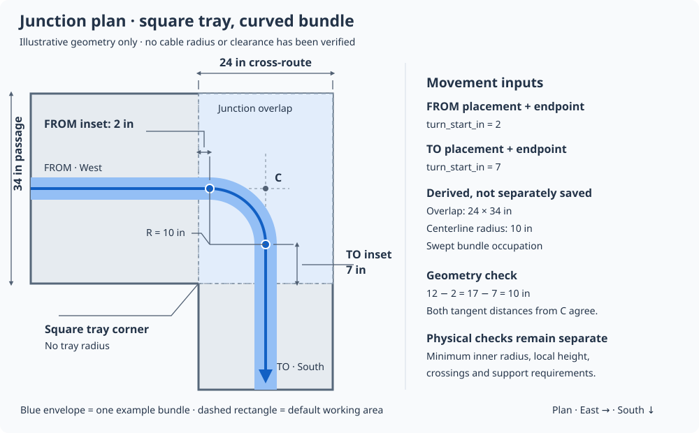

# Junction occupation and bundle turns

Status: junction domain model, curve resolver, intersection statistics and app inspector implemented on `codex/junction-geometry` (2026-10-23). Manufacturer handling profiles, engineered crossover humps, individual-cable packing and route-cost optimization remain future work. The design notes below distinguish those extensions from the current implementation.

## Implemented contract

Migration `187a4f03c852` adds `RoutingJunctionArea`, `RoutingJunctionCrossing` and nullable area/tangent references on the existing bundle connection. Areas use passage + cross-route or station + tier domain anchors, not persisted graph nodes. The graph retains one physical node per tier and exposes derived count/status/scope fields. Saved straight/quarter-circle geometry is counted analytically (`LINE_CIRCULAR_ARC_V1`); no rendered SVG samples determine the statistics.

`GET /routing/layouts/{uid}/junction-preview?node_id=…` returns the working area, ports, enabled saved bundle movements, crossing order and statistics. `actual_groups=true` reads the current real group routes, including manual assignments, and proposes clearly labeled display-only 2 × 1 inch occupations. It does not create memberships, placements, openings or route assignments. The complete routed-group metadata is cached for 30 seconds, bounded to two revisions and invalidated by inventory timestamps/counts, layout geometry and manual-route records. Individual cable rows are not cached/materialized for the preview.

Counts on the graph and `/junctions` endpoint have scope `CONFIGURED_MOVEMENTS`: unconfigured nodes remain `UNKNOWN`, while explicitly configured empty nodes return zero. An actual-group preview has scope `ACTUAL_GROUPS_SCHEMATIC` and reports `ESTIMATED` counts, or `UNKNOWN` if any movement is unresolved. Counts are per bundle centerline, not measured intersections of individual cables. Different tiers never intersect each other; coincident plan runs are reported separately. UI filtering and plan/underside transforms do not alter the node total.

The inspector is available in both the conceptual cabinet map and geometric routing page. It supports tier selection, mirrored plan/underside viewing, working-area editing, turn-start editing and over/under configuration. Clicking a bundle in a port section retains all connection sections and the plan, emphasizes that movement and filters the actual cable-group panel. Physical/grid modes share one toggle; the existing passage-tier sections remain available below the junction inspector. Empty ports still render sections.

Persisted dimensions and turn-start inputs remain integer inches. Transient derived centers/arcs can contain fractional inches from halving odd-width rectangles. Width-derived square tray envelopes and optional arm extensions constrain the turn; a sampled inner/outer envelope fit check is separate from the analytic crossing count. Changing a working-area boundary preserves saved physical tangent locations by adjusting its boundary-relative insets, or rejects an edit that would exclude them. Graph planar lengths and manual route legs are untouched.

Validation rejects inconsistent circular tangents, nonexistent arm extensions, crossing-order cycles, saved endpoint heights/clearances that contradict the chosen stack, and planar turn parameters on straight or tier-changing movements. Grid-only/legacy connections remain usable with unknown physical geometry. Minimum manufacturer bend limits, supports, usable height when absent and vertical travel remain unchecked; the app makes no installation-validity or exact cable-length claim.

## Existing foundation

The derived graph already represents passage/row intersections and physical tier openings. It is regenerated from domain records; generated graph nodes and edges are not persisted.

`RoutingBundlePlacement` references an existing bundle/group and describes its occupation on a pathway span: a multi-cell footprint in the default 12-column by 8-row sectional grid, a physical sectional rectangle, or both. `RoutingBundleConnection` links two placements' START/END endpoints for the same referenced bundle/group. The backend validates common junction location, enabled pathways and explicit openings for adjacent-tier changes. The junction extension adds optional planar turning and crossing metadata without changing those memberships or routes.

Extend this foundation rather than making a graph node hold an unrelated list of cables.

## Topology point and physical working area

Keep the graph node as a connectivity point. Add an optional persistent `RoutingJunctionArea` as the local physical working area around that point on a configured routing tier:

- Stable domain UID and layout reference.
- Passage and intersection anchor: cabinet cold-route or section-gap route reference, or an explicit station for a standalone passage station. Derive row/gap stations so they continue to move with section geometry.
- Default plan footprint derived from the widths and directions of the incident pathways, plus optional explicit extent overrides and usable height above the tier's tray bed. Unknown height stays null.
- Cardinal reference frame, notes, enabled state and whether the configuration is schematic, manually specified or measured.

Do not use a generated node ID as a persistent foreign key. Resolve it from the domain anchor. Coincident CENTRAL intersections have one physical area per tier, with ports for all incident pathways, rather than duplicate working volumes for aligned north/south row records. Contradictory coincident area configurations must be reported.

Incident ports refer to stable domain span endpoints. Their local sectional axes are width-across and height-above-tray-bed, with an explicit cardinal orientation. Reuse the existing section conventions: INNER faces cabinets/hot aisle where defined; CENTRAL has no INNER side. A turn must transform the incoming rectangle into the outgoing port's reference frame; it cannot simply reuse screen X or assume that their left/right directions agree.

### Width-derived plan footprint

For a perpendicular passage/cross-route intersection, derive the central overlap rectangle from the two widths. In the existing hall coordinates, a cross-route of width `Wc` occupies X from `anchor_x - Wc/2` to `anchor_x + Wc/2`; a passage of width `Wp` occupies Y from `anchor_y - Wp/2` to `anchor_y + Wp/2`. The overlap is therefore `Wc` by `Wp`. These dimensions are resolved from domain records, not copied into a second authoritative junction-width record.

The complete tray outline is the union of the incident straight pathway envelopes. Only present arms contribute: an L, T or four-way intersection must not acquire a missing arm. All tray corners remain square. A rounded cable path does not round the tray or introduce a tray bend-radius field. At unequal-width or asymmetric intersections, derive ports from the actual incident envelopes and report inconsistent geometry rather than inventing an adapter.

Use the overlap boundary as the default local port boundary for a perpendicular intersection. If a turn needs to start farther along a tray arm, explicitly extend that working area along the arm and recompute its port boundary. The extension cannot create tray area outside the incident envelopes. Preserve the area mode/provenance so the footprint is not accidentally treated as field measured.

Width alone does not establish usable vertical clearance, supports, separators or a cable's minimum bend radius. It defines the default plan boundary only. A rectangular bounding box of the full junction is also not the usable tray polygon: the absent quadrant of an L junction remains outside the tray.

## Bundle movements through the junction

Extend `RoutingBundleConnection` with a junction-area reference and optional movement geometry:

- Movement kind: straight, turn or explicit tier-opening traversal.
- Existing incoming/outgoing placement and endpoint references, retaining the actual bundle/group's cable membership.
- Two nullable integer-inch turn-start distances, `from_turn_start_in` and `to_turn_start_in`, as defined below; local height/stack arrangement and intent/measurement provenance.
- Reference to a configured cable-handling profile; missing requirements remain unknown.

### Two turn-start distances

For a turning connection, each distance is measured from its referenced port boundary inward into the junction, along that placement's straight bundle centerline. It locates the tangent point where the cable bundle leaves its straight run. The outgoing endpoint is measured inward from its own boundary as well; its tangent point is where the bundle becomes straight when traversing from FROM to TO. FROM/TO refer to the existing placement endpoints, not signal direction. Reversing traversal swaps their roles without changing the physical curve.

Both distances must be supplied together and must be nonnegative. Straight movements leave them null. A zero value means the turn starts at the port boundary. A tangent point must lie inside the configured working area; enlarge that area explicitly if the bend must begin on an adjoining arm. Moving an extended boundary does not silently move a saved tangent point: preserve its anchored physical position and recalculate its boundary-relative distance, or report an invalidated placement for review. Derived row/gap anchors still move with their parent geometry.

For an initial 90-degree turn, derive a circular centerline arc from the two tangent points and their straight directions. Intersect the two extended straight bundle centerlines at virtual corner `C`. The distances from `C` to both tangent points must be equal and positive for a circular, tangent-continuous quarter turn. Boundary-relative turn-start values can differ when the tray widths or bundle offsets differ. Reject an inconsistent pair for this curve type; do not silently substitute a free-form spline or call it a circular radius. An unequal footprint across the two ports likewise needs an explicitly designed transition, not an assumed constant-width bend.

For example, with centered bundle placements, a 24-in cross-route and a 34-in passage give a 24-by-34-in overlap. Entering from WEST and leaving SOUTH, a 2-in FROM inset and a 7-in TO inset both place their tangent points 10 in from `C`, yielding a 10-in centerline radius. This is an illustrative geometry example, not a selected or verified cable-handling radius.

Do not store an independent planned radius that can contradict these two inputs. Derive the planned centerline radius; keep the manufacturer's required minimum inner radius as a separate handling constraint. A smooth-looking Bézier is not evidence that a bend-radius requirement has been met. A radius check must consider the innermost cable path, not just the bundle centerline. For a constant-width planar bundle swept normally along a circular centerline, its inner envelope radius is the centerline radius minus half the occupied width. Missing or changing envelope dimensions leave that check unresolved.

Persist the design inputs, not a redundant sampled curve or mesh. Generated curves and a conservative occupation envelope can support plan, elevation and section views. Grid-only footprints remain schematic unless the cell-to-dimension mapping is explicitly configured; never infer physical inches from a 12x8 array alone. Conservative bounding-box overlap should be labeled a possible conflict, not proof that actual swept volumes collide.

The two turn-start distances define a planar corner; they do not define a vertical climb, crossover hump or opening traversal. Those movements still need local height/clearance information. Keep a valid graph route usable even when this optional physical movement geometry is unchecked.

### Complex display-only fixture

[The multi-bundle fixture](fixtures/routing_junction_multi_bundle.json) describes a 34-in NORTH-passage / 24-in Row 3 T-junction on Tier 1, with eight bundle movements referencing 180 unique synthetic cable IDs. Six bundles turn into the row route and two continue straight along the passage. It covers LC, Cat6, MPO, MPO trunk T2-T1-RO, cross-section LC and cross-section Cat6. No saved application routes or cable memberships are changed. This proposal fixture is not an existing routing API payload.

Each endpoint uses a physical occupation rectangle, measured across from the explicitly specified INNER side and up from the tray bed. NORTH-passage INNER is SOUTH; the fixture's Row 3 is explicitly pair position A with INNER to the EAST. The whole junction remains at Tier 1 (98 in AFF). Different bundle offsets above that bed describe local stacking, not extra routing tiers or physical openings. All occupation sizes and stack offsets are illustrative; the 12-in section window is a display range, not a measured tray clearance.

The fixture's plan has seven centerline crossings. Its selected local stacking places Cat6 below LC; other bundle orderings are explicit fixture choices. A plan/underside view uses opposite occlusion order without changing the physical ABOVE/BELOW relation. West/east/south port sections show the same endpoint rectangles with cardinal labels. Representative strands inside the rendered ribbons are not individual-cable packing claims; cable counts derive from the referenced synthetic ID arrays. Cable-specific minimum bend radii, support requirements and actual usable height remain unknown.

## Crossings and stacking within one tier

Add a small `RoutingJunctionCrossing` relation between movements, recording which passes above/below, a specified clearance if known, and any separator/support reference. Derive crossing locations from their paths; do not give the entire junction one global stacking order when paths only cross locally.

Cat6 below LC is a configurable preferred arrangement. It must not silently rewrite a saved manual arrangement, invent an MPO position, or claim the lower bundle is a structural support for the upper one. Fiber protection from pressure/crushing and suitable support remain relevant even with the preferred order.

An OVER/UNDER relation alone is not a verified clearance. For example, an upper bundle's bottom must clear the lower bundle's top by the configured amount, and both movements must fit within the area's known usable height. Unknown clearance, support or envelope dimensions mean unchecked. Crossing-order cycles and inconsistent height assignments must be reported.

Local stacking layers are distinct from routing tiers. Passing over another bundle inside a tray does not introduce a new graph tier or a tier-changing edge. A real T1/T2/T3 change still requires the existing explicit physical opening.

### Derived intersection counts per node

Add the following statistics to the proposed resolved junction/node representation for later optimization:

| Field | Meaning |
| --- | --- |
| `cable_intersection_point_count` | Number of distinct planar locations with a proper crossing between enabled bundle centerlines inside this physical junction area on this tier. Nonnegative integer, or null when movement geometry is incomplete. |
| `bundle_pair_crossing_count` | Number of unordered bundle-movement pairs at those crossing locations. The same pair crossing twice contributes two. Nonnegative integer, or null when incomplete. |
| `intersection_count_status` | `EXACT`, `ESTIMATED` or `UNKNOWN`, with the geometry method/version identifying how the count was derived. |

Count from the full resolved movement set before selection, cable-type filters, tier visibility or viewing-side transforms. The count belongs to the physical junction area/tier, rather than to one incident edge or a duplicate domain association at the same graph node. Reversing FROM/TO or changing plan/underside view must not change it. Aggregate hall-wide totals once per physical area/tier; keep tier-level values available instead of flattening all tiers onto one plan.

Counting rules:

- Count an interior transverse plan crossing even if one bundle passes safely above the other within the same routing tier. This is a routing-complexity measure, not a collision count. Crossings across distinct routing tiers do not contribute to each other's node counts.
- Exclude shared port endpoints, intentional continuation/join points, self-intersections of one movement, tangential touches, and coincident/collinear runs from this proper-crossing metric. Record overlaps or contacts separately for occupation/conflict checking; a zero point count does not establish physical validity.
- Deduplicate the same unordered movement pair/location returned twice at adjacent sampled segments. Distinct geometric crossing locations remain distinct; use a deterministic geometry-solver numerical tolerance/version, not inch rounding, pixels, zoom or a display collision radius.
- Three movement pairs crossing at one common XY location produce one intersection point and three bundle-pair crossings. Keep both counts so an optimizer can distinguish that concentration from a simple pair crossing.
- Bundle size does not multiply the point count. Two bundles of 16 and 24 cables crossing once contribute one point and one bundle-pair crossing, not 384 measured individual-cable intersections. A separate cable-count weight can be added later if needed.
- Complete, known-empty geometry returns zero. Missing/incomplete geometry returns null with `UNKNOWN`, never an optimistic zero. A sampled preview reports `ESTIMATED`; exact curve-solving support must explicitly report its method/version before supplying `EXACT` counts. An optimizer must define how it treats unknown and estimated values.

Derive or revision-cache these statistics from the movement geometry; do not add an independently editable database counter or persist redundant generated graph records. Invalidate on route, occupation, turn-start, enable-state, tier, width or working-area changes. Physical clearance checks remain separate, and existing manual assignments are not changed by exposing these metrics.

The display-only fixture returns **7 intersection points and 7 bundle-pair crossings** for its Tier 1 node. Selecting bundle A shows its 4 participating points while the node total stays 7. The earlier illustration used sampled centerlines; the backend regression now verifies the same values with analytic line/circular-arc solving. The fixture stores an expected test result, not an editable node counter. Schematic source geometry still cannot establish measured crossing counts.

## Handling requirements and dimensions

Use the actual cable construction/SKU and manufacturer requirements to supply diameter or bundle envelope, installed minimum bend radius and installation/under-load minimum bend radius. LC/MPO connector labels and Cat6 category are insufficient to select one universal numeric radius. A bundle uses the most restrictive requirement among its applicable members for the operation being checked; missing member specifications prevent a complete verification.

Retain integer-inch bundle geometry for the current model. Preserve source specification values/units and references, and convert requirements conservatively upward when checking at whole-inch resolution. Do not round a required minimum down. This resolution is not suitable for claiming precise individual-cable packing or exact cable travel. Sub-inch modeling needs an explicit later precision decision across the backend, API and UI.

Manufacturer guidance distinguishes installed and under-load bend limits and calls out protection from crushing and later cable installation:

- [Corning: Cable Trays and Ladder Racks, 005-014](https://www.corning.com/catalog/coc/documents/standard-recommended-procedures/005-014.pdf)
- [Corning: Duct Installation of Fiber Optic Cable, 005-011](https://www.corning.com/catalog/coc/documents/standard-recommended-procedures/005-011.pdf)

## Validation and technician view

Keep topological routing validity separate from physical checks. Each physical check should return OK, conflict or unchecked, with a reason and the affected movements. Unknown geometry must not be presented as a validated installation.

Checks should cover enabled continuation of the same cable group; available junction area/ports; entry/exit footprint continuity and orientation; minimum inner radius; movement occupation inside the configured area; clearance at crossings; contradictory stack order; and opening-specific fit where a tier changes. Initial physical warnings should not silently reroute cables or overwrite manual assignments.

Selecting a junction should show:

1. A local SVG top-down plan view of the square tray footprint, placement envelopes, straight/turning bundle paths and editable turn-start markers, with over/under indications. Cable geometry comes from the backend movement resolver; React applies only the display transform.
2. A sectional or elevation view showing occupation and stack order within each routing tier.
3. Actual group membership, handling-spec source and unresolved checks.

Implementation sequence: domain area/connection/crossing metadata and validation first; local preview second; optional route-cost integration only after geometry and specifications are available. These additions do not require CAD or a surveyed hall model.

Provide a clearly labeled top-down/reflected-ceiling view switch for the same resolved movement geometry. Use an explicit mirrored display convention and transform the cardinal compass, ports, selection and hit targets together. A view change must not alter stored coordinates, placement sides, actual over/under relationships or graph connectivity. Show overlap breaks/bridges according to which bundle is nearer the selected viewing side; retain explicit ABOVE/BELOW labels so the physical stack order remains clear. Handle tier visibility independently; tier elevation is not screen depth.

Existing PLANAR PATHWAY LENGTH remains unchanged. Future bend-travel estimates must trim the consumed straight portions and count each junction curve once, without adding a curve to an already counted corner. Unknown vertical travel, rack drops and slack still prevent reporting an exact cable length.
